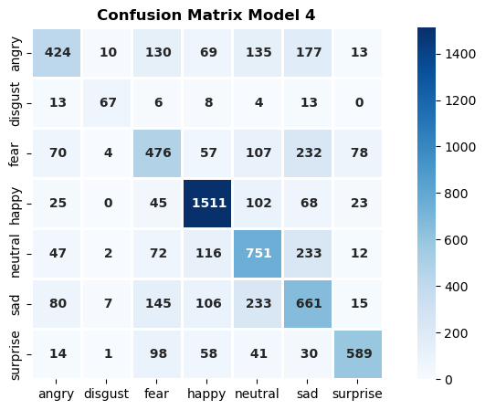
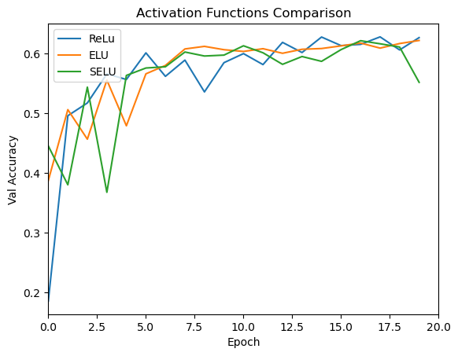

# Facial Emotion Recognition with a Convolutional Neural Network

Convolutional neural network that classifies facial expressions into seven emotions (angry, disgust, fear, happy, neutral, sad and surprise) from 48x48 grayscale images, with a comparison of activation functions and hyperparameters.

Group project for the Artificial Intelligence in Biomedical Engineering course of the BSc in Biomedical Engineering, Universitat de Barcelona.

## Overview

Facial expressions are one of the main ways people show emotion, but they are not always easy to interpret, for example for people with autism or for paediatric patients. The project asks whether a neural network can classify the emotion in a face image, and explores where such a tool could help in healthcare: patient communication, monitoring of conditions such as depression and anxiety, and patient experience in consultations.

Six versions of the same network were trained and compared, changing the activation function (ReLU, ELU and SELU), the dropout rate, the batch size and the number of epochs. The best model is used to predict the emotion of new images and to plot the probability of each emotion.

## Results

All values are for the 7178 images of the test set, which was also used as the validation set during training.

| Model | Activation | Dropout | Batch size | Epochs | Train accuracy | Validation accuracy | Validation loss |
|-------|------------|---------|------------|--------|----------------|---------------------|-----------------|
| 1 | ReLU | 0.20 | 64 | 20 | 98.5% | 62.7% | 1.61 |
| 2 | ELU | 0.20 | 64 | 20 | 98.4% | 62.2% | 1.74 |
| 3 | SELU | 0.20 | 64 | 20 | 87.4% | 55.2% | 2.03 |
| 4 | ELU | 0.30 | 64 | 20 | 96.9% | 62.4% | 1.41 |
| 5 | ELU | 0.20 | 128 | 20 | 96.8% | 60.2% | 1.66 |
| 6 | ELU | 0.25 | 64 | 30 | 99.4% | 61.8% | 1.81 |

Model 4 is the one used for predictions. Its per-class F1 scores are: happy 0.82, surprise 0.75, disgust 0.66, neutral 0.58, angry 0.52, sad 0.50 and fear 0.48 (macro F1 0.62).

Key findings:

- The models reach about 62% accuracy on a seven-class problem, where random guessing would give about 14%.
- Happy faces are recognised best. Fear, sad and angry are the hardest and are often confused with each other and with neutral.
- ReLU and ELU perform similarly, and SELU is clearly worse (55.2%).
- All models overfit: training accuracy is 87 to 99%, but validation accuracy is only 55 to 63%. A higher dropout rate (Model 4) kept the accuracy and lowered the validation loss from 1.74 to 1.41.
- A larger batch size (128) and more epochs (30) did not help.
- Predictions on a few new photos were mixed: confident on clearly happy faces, but unreliable on subtle expressions.





## Data

The project uses a facial expression dataset from [Kaggle](https://www.kaggle.com/datasets/aadityasinghal/facial-expression-dataset) with 28709 training images and 7178 test images. Each image is a 48x48 grayscale face, sorted into folders by emotion: angry, disgust, fear, happy, neutral, sad and surprise. 

The 7178 test images are distributed as: angry 958, disgust 111, fear 1024,
happy 1774, neutral 1233, sad 1247 and surprise 831. The disgust class is
much smaller than the others.

## Methods

1. **Exploration:** distribution of emotions in the training and test sets, and sample images.
2. **Preprocessing:** images loaded in grayscale at 48x48 pixels, pixel values scaled to the range 0 to 1, and labels one-hot encoded.
3. **Model:** a sequential CNN with three blocks of convolutional layers (64, 128 and 256 filters of size 3x3), each followed by batch normalisation, 2x2 max pooling and dropout, then a flatten layer, a dense layer of 128 units and a softmax output layer with 7 units (2.29 million parameters). The architecture was inspired by a public Kaggle notebook.
4. **Training:** categorical cross-entropy loss and the Adam optimiser, 20 epochs with batch size 64 for the base model.
5. **Experiments:** activation functions (ReLU, ELU and SELU), dropout rate (0.2, 0.25 and 0.3), batch size (64 and 128) and number of epochs (20 and 30).
6. **Evaluation:** accuracy and loss curves, classification reports and confusion matrices for each model.
7. **Prediction:** a function that loads an image, converts it to the model input, and plots the probability of each emotion.

The full comparison of the models is in [`docs/emotion_recognition_report.pdf`](docs/emotion_recognition_report.pdf).

## Repository structure

```
.
├── docs/
│   ├── emotion_recognition_presentation.pdf
│   └── emotion_recognition_report.pdf
├── figures/              
├── notebooks/
│   ├── 01_emotion_cnn_training.ipynb
│   └── 02_emotion_prediction.ipynb
├── README.md
└── requirements.txt
```

## How to run

```bash
git clone https://github.com/cindychenqiu/facial-emotion-recognition-cnn.git
cd facial-emotion-recognition-cnn
python -m venv .venv
source .venv\Scripts\activate # on macOS/Linux .venv/bin/activate 
pip install -r requirements.txt
jupyter notebook
```

To predict the emotion of an image, open `notebooks/02_emotion_prediction.ipynb`, which loads the saved model, and call `predict_image("path/to/your_image.jpg")`.

To retrain the models, download the dataset (see [Data](#data)) and run `notebooks/01_emotion_cnn_training.ipynb`.

Tested with Python 3.9.13.

## Limitations and next steps

- **No independent test set:** the same images were used as the validation set during training and to choose between models, so the reported accuracy is slightly optimistic. A separate validation split is the first improvement.
- **Strong overfitting:** the gap between training accuracy (about 97%) and validation accuracy (about 62%) is large. Data augmentation, a tuned learning rate and optimiser, and transfer learning are natural next steps.
- **Class imbalance and label quality:** the disgust class has very few examples, and expression datasets of this kind have noisy labels.
- **Faces only, no face detection:** the model expects cropped 48x48 faces. A webcam application would need a face detection step.
- **Bias:** the demographic composition of the dataset (age, ethnicity and gender) was not analysed, so performance across groups is unknown.
- **Not a clinical tool:** a facial expression is not the same as an internal emotional state, and the model has no clinical validation, so it must not be used for diagnosis.
- **Privacy and consent:** facial images are personal data. Any real use, for example in consultations or with newborns, would need consent, secure storage and a clear purpose.

## Authors and acknowledgements

Group project by Maria Guasch, Núria Moll and Cindy Chen.  
    
[LinkedIn](https://www.linkedin.com/in/cindychenqiu/) | [GitHub](https://github.com/cindychenqiu)